# CICR - Centre for Innovation in Computational Robotics
### The Official Robotics & Autonomous Systems Hub of JIIT-128 (React Edition)



A cutting-edge, high-performance official web application for **CICR (Creative & Innovative Cell in Robotics)** at Jaypee Institute of Information Technology (JIIT Sector 128, Noida), engineered entirely with modern **React**, **Three.js**, **Vite**, and **Lucide Icons**.

---

## 🚀 Key Pages & Architecture

### 1. 🪐 Landing Page with 3D Cybernetic Core
- **Interactive Three.js 3D Visualizer**: Real-time rendering of an autonomous robotic gimbal/gyroscope core, glowing icosahedron compute engine, orbiting sensor satellites, ambient particle starfield, and pointer tracking.
- **Bold Cyberpunk Typography & HUD**: Electric Cyan & Laser Indigo gradients, dynamic telemetry status ticker (`ROS2 HUMBLE CORE LOADED // ROOM 140 JIIT-128`).
- **Live Metrics Ticker**: Real-time statistics counters for active engineers, engineered bot prototypes, national podiums, and mentored students.
- **The 4 Engineering Wings**: Autonomous Navigation & ROS, Embedded Systems & Custom PCB Design, Computer Vision & Edge AI, and Combat & Sports Robotics.
- **Bot Fleet Showcase with Live Category Filters**: *Robo-Soccer Striker V2*, *Algo-Benchmaker*, *Autonomous LiDAR SLAM Rover*, *Circuit Rush Speedster*, *Tactical Quadcopters*, and *IoT Diagnostics*.
- **Dedicated Inventory Site Spotlight**: High-impact feature section promoting the component lending system.
- **Recruitment Roadmap 2026-27**: Step-by-step 4-stage onboarding guide for new recruits.
- **Interactive FAQ & Direct Transmission**: Fast accordion Q&A and instant message form.

### 2. 👥 Dedicated Team Page
- Complete roster with category filters: **All Members**, **Faculty & Mentors**, **Core Leadership**, **Technical Wing Leads**, and **Alumni Network**.
- Member cards with domain badges, departments, role descriptions, bios, and direct links to **LinkedIn**, **GitHub**, and **Email**.
- "Join the Team" recruitment callout banner.

### 3. 📅 Dedicated Events & Workshops Page
- Complete event catalog with category filters: **All Events**, **Upcoming Bootcamps**, **Arena Tournaments**, and **National Expeditions**.
- **TechTonic 3.0 Deep Dive**: Detailed 3-day curriculum breakdown (Microcontrollers & Sensors &rarr; Chassis Assembly & Soldering &rarr; ROS Nodes & Arena Championship).
- Tournament archives for **Robo Soccer Arena Championship** and **Circuit Rush Obstacle Sprint**.
- National expeditions recap for **Techfest (IIT Bombay)** and **Plinth (LNMIIT)**.

### 4. 📦 Inventory Site Button
- Prominent button featured in the fixed glassmorphic navigation header, hero section, and dedicated portal spotlight.
- Seamlessly redirects users to the live deployed external portal: **[`https://inventory.cicr.in`](https://inventory.cicr.in)**.

### 5. 🤖 Autonomous AI Assistant
- Integrated React glassmorphic modal assistant with instant client-side responses powered by CICR's knowledge base.
- Quick prompt chips for *Recruitment 2026*, *TechTonic Bootcamp*, *Inventory Portal*, *Room 140 Lab*, and *Bot Fleet*.

---

## 🛠️ Modern Tech Stack

- **Framework**: [React 18](https://react.dev/)
- **Bundler & Dev Server**: [Vite 6](https://vitejs.dev/)
- **3D Graphics**: [Three.js](https://threejs.org/) (Custom WebGL holographic core & particle nebula)
- **Icons**: [Lucide React](https://lucide.dev/)
- **Styling**: Modern CSS3 Custom Properties, Glassmorphism, CSS Grid & Flexbox
- **Typography**: Google Fonts (`Orbitron`, `Syne`, `Inter`, `JetBrains Mono`)
- **Deployment**: Vercel ready (`dist/` build output + `vercel.json` SPA rewrites)

---

## 📁 Repository Structure

```
CICR-Website/
├── public/
│   └── cicr-logo.png          # Official high-resolution CICR logo
├── src/
│   ├── components/
│   │   ├── Canvas3D.jsx       # Three.js 3D Interactive Cyber-Robotics Core
│   │   ├── Navbar.jsx         # Fixed glassmorphic navbar with Inventory Site button
│   │   ├── Footer.jsx         # Cyber dark footer with links & Room 140 location
│   │   └── AIChatModal.jsx    # Autonomous AI Assistant modal widget
│   ├── pages/
│   │   ├── LandingPage.jsx    # 3D Hero, Ticker, Wings, Fleet, Inventory Spotlight
│   │   ├── TeamPage.jsx       # Dedicated Team & Mentors page
│   │   └── EventsPage.jsx     # Dedicated Workshops & Events page
│   ├── data/
│   │   ├── teamData.js        # Faculty, leadership, wing leads, and alumni records
│   │   └── eventsData.js      # TechTonic 3.0, tournaments, and schedules
│   ├── App.jsx                # SPA state router with hash synchronization
│   ├── main.jsx               # React 18 DOM mount
│   └── index.css              # Master styling system
├── previous-code/             # 100% UNTOUCHED archive of the previous website
│   ├── chatbot_backend/
│   ├── index.html
│   ├── chatbot.css
│   ├── chatbot.js
│   ├── cicr-logo.png
│   └── README.md
├── index.html                 # Vite HTML entry point
├── package.json               # NPM package configuration
├── vite.config.js             # Vite configuration
└── vercel.json                # Vercel deployment & rewrite rules
```

---

## 💻 Getting Started Locally

```bash
# 1. Install dependencies
npm install

# 2. Run local development server
npm run dev

# 3. Build optimized production bundle
npm run build

# 4. Preview production build
npm run preview
```

---

## 🔒 Untouched Legacy Code

All previous code and legacy files remain completely preserved and untouched in the **[`previous-code/`](previous-code/)** folder.
